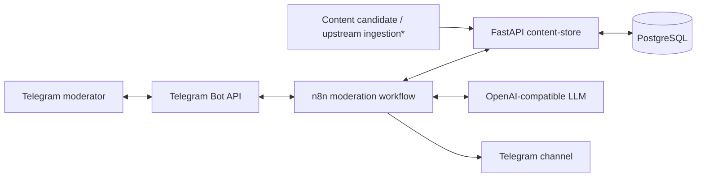

# AI News Automation

**An AI-assisted content moderation and publishing system built with n8n, FastAPI, PostgreSQL, and Telegram.**

A practical automation project focused on **reliable integrations**, **human-in-the-loop approval**, and **maintainable workflows**. An OpenAI-compatible LLM can revise or regenerate drafts, while application code handles candidate state, persistence, and publishing decisions.

**Project status:** local portfolio MVP. The Telegram moderation/publishing workflow and the content-store service are included in this repository. The full RSS ingestion and client-review n8n workflow exports are **not** currently included; see [Scope and limitations](#scope-and-limitations).

> **Коротко українською:** автоматизація модерації та публікації контенту в Telegram через n8n, LLM і FastAPI. Акцент на інтеграціях через API, контролі статусів, дедуплікації та обробці помилок.

## Overview

Editorial publishing often involves several disconnected steps: reviewing a draft, correcting its wording, deciding whether to publish, and ensuring the same item is not posted twice.

This project separates those responsibilities:

- **n8n** coordinates Telegram actions, external API calls, and LLM-powered editing.
- **FastAPI + SQLAlchemy** manage candidates, approval state, validation, events, and reporting.
- **PostgreSQL** stores content, moderation history, deduplication keys, and execution metadata.
- **Telegram Bot API** provides the review interface and final publishing destination.
- **An OpenAI-compatible AI endpoint** supports draft editing and regeneration (including a local model gateway).

The intention is not to replace editorial judgment with an LLM. A human reviewer stays in control of publication.

## Implemented functionality

| Area | Available in the repository |
| --- | --- |
| Telegram moderation | n8n workflow for authorized moderators, approval, rejection, editing, and regeneration |
| Publication | Telegram channel posting with database-backed state transitions and stored message IDs |
| AI integration | LLM nodes for editing and regenerating content through OpenAI-compatible credentials |
| Candidate management | FastAPI endpoints for reserving, retrieving, analyzing, editing, and publishing candidates |
| Deduplication | PostgreSQL uniqueness constraint and atomic candidate reservation |
| Quality checks | Server-side relevance, language, confidence, and quality-score checks |
| Recovery and observability | Failed-processing state, retry eligibility, publication release path, moderation events, and summary metrics |
| Source processing | HTTP article-fetch endpoint with host/IP checks, response-size limits, and timeouts |
| Deployment | Local Docker Compose stack for n8n, content-store, and PostgreSQL |

**Important distinction:** the content-store API supports ingestion and analysis, but the n8n export that automatically pulls items from RSS and sends them through that pipeline is not committed in this repository. The committed n8n workflow covers the **review and publishing stage**.

## Architecture



*The upstream ingestion workflow is an integration point, not an included n8n export.*

The service and workflow communicate through **REST/HTTP**. Persistence and business-state validation live in the backend rather than being scattered across n8n nodes.

### Publishing lifecycle

```text
processing
   ├── filtered
   ├── failed  ──(eligible retry)──> processing
   └── pending_review
          ├── rejected
          └── publishing
                 ├── published
                 └── pending_review  (release after a reported failure)
```

The approve operation conditionally changes a candidate from `pending_review` to `publishing`. Only the successful claimant receives permission to continue publishing. The workflow then records the Telegram message ID after posting.

This reduces duplicate publish attempts and provides recovery paths. As with other integrations involving an external API and a database, a failure between sending a Telegram message and recording its result still requires operational care.

## n8n workflow

**Primary workflow:** [`02-telegram-moderation-publish-orm.json`](workflows/02-telegram-moderation-publish-orm.json)

The workflow polls Telegram updates and routes moderator actions through the content-store API. Its main paths include:

1. **Authorization:** check whether the Telegram user is allowed to moderate.
2. **Approve / reject:** update the candidate state through the API.
3. **Edit / regenerate:** request a revised draft from an LLM, validate the result, and persist the changes.
4. **Publish:** send approved content to the target channel and record the result.
5. **Failure handling:** notify the moderator and use the backend release endpoint where applicable.

The exported workflow uses n8n HTTP Request, Code, IF, Schedule Trigger, and AI/LangChain nodes. AI credentials are **referenced, not shipped** with the export.

The older [`02-telegram-moderation-publish.json`](workflows/02-telegram-moderation-publish.json) is retained as a legacy reference; use the **ORM** workflow for the current implementation.

## Tech stack

| Layer | Technology |
| --- | --- |
| Workflow automation | n8n |
| Backend API | Python 3.12, FastAPI, Pydantic, SQLAlchemy |
| Database | PostgreSQL 16 |
| AI integration | OpenAI-compatible Chat Completions endpoint / local AI gateway |
| Messaging | Telegram Bot API |
| Infrastructure | Docker, Docker Compose |
| Interfaces | REST APIs, HTTP requests, environment-based configuration |

## Run locally

### Prerequisites

- Docker and Docker Compose
- A Telegram bot, a review chat, and a destination channel
- Access to an OpenAI-compatible LLM endpoint for AI-assisted edit/regeneration
- Credentials for the above services

### 1. Configure the environment

```bash
cp .env.example .env
```

On PowerShell, use `Copy-Item .env.example .env`.

Edit `.env` and replace the sample values. At minimum, set:

```dotenv
POSTGRES_PASSWORD=<strong-random-password>
N8N_ENCRYPTION_KEY=<long-random-encryption-key>
AI_GATEWAY_BASE_URL=<your-reachable-openai-compatible-api-url>
AI_GATEWAY_API_KEY=<your-ai-api-key>
TELEGRAM_BOT_TOKEN=<your-bot-token>
TELEGRAM_REVIEW_CHAT_ID=<review-chat-id>
TELEGRAM_TARGET_CHANNEL_ID=<target-channel-id>
TELEGRAM_MODERATOR_IDS=<allowed-user-id>
```

Do not commit `.env` or real credentials. The API address must be reachable **from inside the n8n container**; `localhost` inside a container is not the host machine. The provided `.env.example` uses `host.docker.internal` for a host-side gateway.

### 2. Start the stack

```bash
docker compose up -d --build
```

| Service | Local address |
| --- | --- |
| n8n editor | [http://127.0.0.1:5678](http://127.0.0.1:5678) |
| Content-store health | [http://127.0.0.1:18090/health](http://127.0.0.1:18090/health) |
| Content-store API docs | [http://127.0.0.1:18090/docs](http://127.0.0.1:18090/docs) |

Check service health:

```bash
docker compose ps
curl http://127.0.0.1:18090/health
```

### 3. Import and configure the n8n workflow

1. Open n8n and import [the ORM workflow](workflows/02-telegram-moderation-publish-orm.json).
2. Configure the Telegram bot token, authorized moderator IDs, review chat, and channel in `.env`.
3. Create the **OpenAI-compatible model credential** required by the AI nodes and attach it to the imported workflow. Match the model and endpoint to your own LLM setup.
4. Review the HTTP Request nodes and environment expressions, then enable the workflow when you are ready.

**To demonstrate the entire review path**, create a test candidate via the content-store API (`reserve`, then `analysis`) or connect an upstream ingestion flow. Simply importing the moderation workflow does not start RSS collection.

### 4. Inspect activity

The backend exposes:

- `GET /v1/metrics/summary` — counts by candidate state and event type
- `GET /v1/candidates/{id}` — candidate and moderation status
- `GET /health` — service health

The implementation records moderation actions and processing events in PostgreSQL.

Stop containers without removing persistent volumes:

```bash
docker compose down
```

## Content-store API

Selected endpoints implemented in [`services/content-store/app/main.py`](services/content-store/app/main.py):

| Method | Endpoint | Responsibility |
| --- | --- | --- |
| `POST` | `/v1/candidates/reserve` | Reserve a candidate and check deduplication |
| `POST` | `/v1/source/fetch` | Fetch and extract source text |
| `PATCH` | `/v1/candidates/{id}/analysis` | Save AI analysis and apply quality gate |
| `POST` | `/v1/candidates/{id}/fail` | Mark a processing failure |
| `GET` | `/v1/candidates/{id}` | Get candidate details |
| `PATCH` | `/v1/candidates/{id}/edit` | Save editorial changes |
| `POST` | `/v1/candidates/{id}/approve` | Claim candidate for publishing |
| `POST` | `/v1/candidates/{id}/publish` | Record Telegram publication |
| `POST` | `/v1/candidates/{id}/release` | Release a publishing claim after failure |
| `POST` | `/v1/candidates/{id}/reject` | Reject a pending candidate |
| `GET` | `/v1/clients/{client_id}/style-context` | Read existing moderation/style context |
| `POST` | `/v1/candidates/{id}/style-review` | Store a style-review prediction |
| `POST` | `/v1/errors` | Record execution errors |
| `GET` | `/v1/metrics/summary` | Return state and event counts |

Request schemas and interactive examples are available in FastAPI's local `/docs` page after startup.

## Engineering decisions

**Keep business rules outside the automation graph.** Candidate lifecycle checks, database writes, deduplication, and quality thresholds belong to the content-store service. n8n focuses on orchestration and third-party integrations.

**Make moderation explicit.** A content item must pass validation and receive moderator approval before it can enter the publication path.

**Design for repeat execution.** The backend uses a unique deduplication key, conditional state updates, processing retry metadata, and persisted Telegram publication identifiers.

**Treat external content cautiously.** The source-fetch implementation checks URL schemes, destinations, host allowlists (when configured), timeouts, and response sizes. AI output is subject to application-level checks rather than being trusted unconditionally.

**Keep credentials out of version control.** Secrets live in local environment variables or credentials configured inside n8n. Local container ports are bound to loopback in the provided Compose setup.

## Repository structure

```text
AI-news/
├── workflows/
│   ├── 02-telegram-moderation-publish-orm.json  # Current n8n workflow
│   └── 02-telegram-moderation-publish.json      # Legacy reference
├── services/
│   └── content-store/
│       ├── app/main.py                         # FastAPI + SQLAlchemy
│       ├── requirements.txt
│       └── Dockerfile
├── sql/init.sql                                # Reference database schema
├── docs/                                       # Design notes and roadmap
├── docker-compose.yml
├── .env.example
└── README.md
```

## Scope and limitations

This repository is a **demonstrable local MVP**, not a claim of a fully deployed production content platform.

- **Included:** Telegram moderation/publishing orchestration, backend candidate lifecycle, validation, persistence, and local deployment.
- **Backend-supported but not exported as a full n8n pipeline:** RSS ingestion, automated initial LLM analysis, and client-specific style review orchestration.
- **Legacy workflow:** the older JSON file is archival, not the recommended import.
- **Security hardening still needed:** the content-store API does not currently implement application-level authentication; keep it restricted to a trusted local/private environment. Additional safeguards, automated tests, and production monitoring are needed before external deployment.
- **Metrics:** operational counts are available, but no measured time-saving or accuracy claims are made here.

### Next steps

- Export and document the complete RSS ingestion → analysis → moderation workflow.
- Package the client-specific style review flow and feedback loop.
- Add API authentication, integration tests, and CI checks.
- Improve retry/backoff behavior, execution monitoring, and operational runbooks.
- Explore e-commerce/marketing integrations and KPI anomaly alerts as separate future modules.

## License

No license has been selected for this project. Unless a license is added, the repository should not be assumed to grant reuse or redistribution rights.
